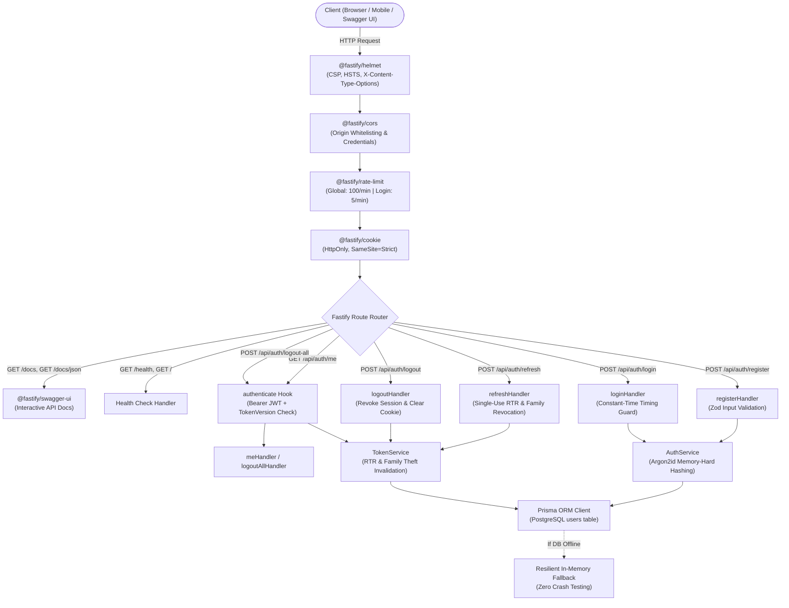

# NexBase Auth Service — Complete Codebase & File Documentation

> **Service**: `nexbase-auth-service`  
> **Runtime**: Node.js (v24+ native TypeScript execution)  
> **Framework**: Fastify v5  
> **API Documentation**: Auto-generated Swagger UI / OpenAPI 3.0 (`/docs` and `/docs/json`)  
> **Database & ORM**: PostgreSQL + Prisma ORM (v6.19)  
> **Security Suite**: Argon2id, Refresh Token Rotation (RTR), HttpOnly Cookies, Fastify Helmet, Rate Limiting, CORS  

---

## 1. System Architecture & Request Lifecycle



---

## 2. Interactive Swagger UI & OpenAPI Specification

The API documentation is automatically generated from Fastify route schemas.

- **Interactive Swagger UI Web Page**: `http://localhost:3000/docs`
- **OpenAPI 3.0 Raw JSON Specification**: `http://localhost:3000/docs/json`

### How to Use Swagger UI for Interactive API Testing:
1. Open `http://localhost:3000/docs` in your web browser.
2. Expand **`POST /api/auth/register`** or **`POST /api/auth/login`**, click **"Try it out"**, fill in credentials, and click **"Execute"**.
3. In the response, copy the generated `accessToken`.
4. Click the green **"Authorize"** button at the top right of the Swagger UI page:
   - In `bearerAuth`, enter: `<your_access_token>`.
   - Click **Authorize**, then **Close**.
5. You can now execute protected endpoints like **`GET /api/auth/me`** or **`POST /api/auth/logout-all`** directly from your browser!

---

## 3. Directory Tree

```text
nexbase-auth-service/
├── .env                              # Active environment variables (git-ignored)
├── .env.example                      # Template for environment variables
├── .gitignore                        # Git exclusion rules (.env, node_modules, dist)
├── app.ts                            # Application entry point (Server listener)
├── guidemap.txt                      # Developer study guide & concepts
├── package.json                      # Dependencies and npm scripts
├── package-lock.json                 # Pinned dependency tree
├── tsconfig.json                     # TypeScript compiler configuration (NodeNext ESM)
├── README.md                         # Project overview and high-level roadmap
├── prisma/
│   └── schema.prisma                 # Prisma schema (User & RefreshToken models)
├── docs/
│   ├── SECURITY_ARCHITECTURE.md      # Cryptographic explanations, attack matrix & theory
│   └── CODEBASE_DOCUMENTATION.md     # Full codebase & file-by-file documentation (this file)
├── src/
│   ├── app.ts                        # Fastify Application Factory (buildApp with Swagger & Helmet)
│   ├── config/
│   │   ├── env.ts                    # Startup environment schema validation (Zod)
│   │   └── db.ts                     # Prisma Client singleton & connection management
│   ├── middleware/
│   │   └── auth.middleware.ts        # Access token & session version authentication hook
│   ├── modules/
│   │   └── auth/
│   │       ├── auth.controller.ts    # Fastify HTTP request/reply handlers
│   │       ├── auth.middleware.ts    # Module export for middleware
│   │       ├── auth.routes.ts        # Fastify plugin route definitions & OpenAPI schemas
│   │       ├── auth.schema.ts        # Zod request validation schemas
│   │       ├── auth.services.ts      # User identity, password verification & hashing
│   │       └── token.services.ts     # JWT signing, refresh token rotation & revocation
│   ├── types/
│   │   └── fastify-jwt.d.ts          # TypeScript declaration merge for JWT payload
│   └── utils/
│       └── password.ts               # Argon2id hashing & dummy timing verification
└── tests/
    └── auth-flow.test.ts             # 11-step automated security, auth & Swagger integration test
```

---

## 4. Comprehensive File-by-File Guide

### Root Configuration

#### [`app.ts`](file:///c:/kajalbharti/nexbase-auth-service/app.ts)
- **Role**: Application Bootstrapper & Network Listener.
- **Responsibilities**:
  - Initializes database connection via `connectDB()`.
  - Instantiates Fastify instance using `buildApp()`.
  - Listens on `env.PORT` and `env.HOST`.
  - Handles graceful startup logging and process termination on fatal error.

#### [`tsconfig.json`](file:///c:/kajalbharti/nexbase-auth-service/tsconfig.json)
- **Role**: TypeScript Configuration.
- **Responsibilities**:
  - Target: `ES2022`, Module: `NodeNext`, Resolution: `NodeNext`.
  - Enables `allowImportingTsExtensions: true` and `noEmit: true` for native Node.js 24 type execution without a build transpile step.

#### [`.env`](file:///c:/kajalbharti/nexbase-auth-service/.env) & [`.env.example`](file:///c:/kajalbharti/nexbase-auth-service/.env.example)
- **Role**: Environment Variable Management.
- **Keys**:
  - `PORT`, `HOST`, `NODE_ENV`: Server runtime parameters.
  - `CORS_ORIGIN`: Whitelist of approved frontend origins.
  - `JWT_ACCESS_SECRET`: Secret key for short-lived access tokens.
  - `JWT_REFRESH_SECRET`: Separate secret key for refresh tokens.
  - `ACCESS_TOKEN_EXPIRES_IN`: Access token duration (`15m`).
  - `REFRESH_TOKEN_EXPIRES_IN`: Refresh token duration (`7d`).
  - `DATABASE_URL`: PostgreSQL connection string.
  - `REDIS_URL`: Redis connection string.

#### [`package.json`](file:///c:/kajalbharti/nexbase-auth-service/package.json)
- **Role**: Dependency & Script Registry.
- **Scripts**:
  - `npm run dev`: Starts server with Node.js `--watch` live-reload.
  - `npm start`: Starts production server.
  - `npm test`: Runs the 11-step in-memory Fastify security & Swagger test suite.
  - `npm run prisma:generate`: Rebuilds Prisma client types.
  - `npm run prisma:push`: Syncs schema directly to PostgreSQL.
  - `npm run prisma:migrate`: Runs migrations.
  - `npm run prisma:studio`: Launches web GUI database inspector.

---

### Database Layer (`prisma/`)

#### [`prisma/schema.prisma`](file:///c:/kajalbharti/nexbase-auth-service/prisma/schema.prisma)
- **Role**: PostgreSQL Data Model & Prisma Client Generation.
- **Models**:
  1. `User` (`users` table):
     - `id`: String (UUID `@id @default(uuid())`).
     - `email`: String (`@unique`).
     - `name`: String (optional).
     - `passwordHash`: String (Argon2id hash string).
     - `role`: Enum `Role { USER, ADMIN }` (defaults to `USER`).
     - `isVerified`: Boolean (default `false`).
     - `tokenVersion`: Int (default `1`, incremented to invalidate all active sessions).
     - `createdAt`, `updatedAt`: Timestamps.
     - `refreshTokens`: One-to-many relationship with `RefreshToken`.
  2. `RefreshToken` (`refresh_tokens` table):
     - `id`: String (UUID).
     - `userId`: Foreign key with `Cascade` delete on User.
     - `familyId`: String grouping all rotations originating from the same login session.
     - `isRevoked`: Boolean tracking if the token has been consumed or invalidated.
     - `expiresAt`: DateTime expiration.
     - `userAgent`, `ipAddress`: Device fingerprinting metadata.
     - Indexes: `@@index([familyId])`, `@@index([userId])`.

---

### Core Source Code (`src/`)

#### [`src/app.ts`](file:///c:/kajalbharti/nexbase-auth-service/src/app.ts)
- **Role**: Fastify Application Factory (`buildApp`).
- **Features Configured**:
  1. **Ajv Validation**: Configured with `strict: false` to allow OpenAPI 3.0 keywords like `example`.
  2. **Security Headers**: `@fastify/helmet` with Content Security Policy, MIME sniff protection (`nosniff`), frameguard (`SAMEORIGIN`), and HSTS. Configured to permit Swagger UI inline scripts and assets.
  3. **CORS Control**: `@fastify/cors` configured to enforce origin checks and allow credentials.
  4. **Brute-Force Rate Limiting**: `@fastify/rate-limit` with RFC 6585 formatted 429 response.
  5. **Cookie Parser**: `@fastify/cookie` for reading and setting `HttpOnly` cookies.
  6. **Swagger Generator**: `@fastify/swagger` auto-generating OpenAPI 3.0 specification.
  7. **Swagger UI**: `@fastify/swagger-ui` serving the interactive documentation at `/docs`.
  8. **Endpoints**: Registers `/health`, `/`, and mounts `/api/auth` with `authRoutes`.

#### [`src/config/env.ts`](file:///c:/kajalbharti/nexbase-auth-service/src/config/env.ts)
- **Role**: Environment Variable Validation.
- **Mechanism**:
  - Uses **Zod** to validate all required environment variables on startup.
  - If a variable is missing or malformed (e.g. secret too short), the server halts immediately with an explanatory error, preventing silent security misconfigurations.

#### [`src/config/db.ts`](file:///c:/kajalbharti/nexbase-auth-service/src/config/db.ts)
- **Role**: Database Connection & Prisma Client Singleton.
- **Exports**:
  - `prisma`: Singleton instance of `PrismaClient`.
  - `connectDB()`: Connects to PostgreSQL, logging status.
  - `disconnectDB()`: Gracefully closes database pools on shutdown.

#### [`src/middleware/auth.middleware.ts`](file:///c:/kajalbharti/nexbase-auth-service/src/middleware/auth.middleware.ts)
- **Role**: Access Control & Session Verification Hook (`authenticate`).
- **Responsibilities**:
  - Validates `Authorization: Bearer <token>` header.
  - Verifies cryptographic signature using `JWT_ACCESS_SECRET`.
  - Verifies `payload.tokenVersion === user.tokenVersion`. If the user changed their password or invoked "Logout All Devices", the access token is rejected immediately even if its signature hasn't expired.
  - Attaches `request.user = payload` to Fastify request.

#### [`src/types/fastify-jwt.d.ts`](file:///c:/kajalbharti/nexbase-auth-service/src/types/fastify-jwt.d.ts)
- **Role**: Type Definitions.
- **Responsibilities**: Module augmentation adding strongly-typed `FastifyJWT` payload containing `userId`, `email`, `role`, and `tokenVersion`.

#### [`src/utils/password.ts`](file:///c:/kajalbharti/nexbase-auth-service/src/utils/password.ts)
- **Role**: Cryptographic Password Utilities (`@node-rs/argon2`).
- **Functions**:
  - `hashPassword(password)`: Hashes plain-text passwords using **Argon2id** (memory: 19MB, timeCost: 2 iterations, parallelism: 1).
  - `verifyPassword(hash, password)`: Constant-time verification.
  - `performDummyVerification(password)`: Runs a dummy Argon2 verification when a requested email does not exist in the database. This guarantees the server takes the exact same amount of time to respond, defeating **Timing Side-Channel / Account Enumeration** attacks.

---

### Auth Module (`src/modules/auth/`)

#### [`src/modules/auth/auth.schema.ts`](file:///c:/kajalbharti/nexbase-auth-service/src/modules/auth/auth.schema.ts)
- **Role**: Request Validation Schemas (Zod).
- **Rules**:
  - `registerSchema`: Email format, lowercase normalization, max 255 chars. Password must be 10–128 chars, containing at least 1 uppercase, 1 lowercase, 1 digit, and 1 special symbol.
  - `loginSchema`: Required email and password strings.

#### [`src/modules/auth/auth.services.ts`](file:///c:/kajalbharti/nexbase-auth-service/src/modules/auth/auth.services.ts)
- **Role**: User Management Service (`AuthService`).
- **Methods**:
  - `register(input)`: Checks for duplicate email, hashes password with Argon2id, persists user to PostgreSQL (or fallback store), and returns safe user record (stripping `passwordHash`).
  - `login(input)`: Looks up user. If missing, triggers dummy Argon2 verify and throws `INVALID_CREDENTIALS`. If found, verifies hash and returns safe user.
  - `findById(id)`: Fetches safe user by UUID.
  - `incrementTokenVersion(id)`: Increments `tokenVersion` by 1 to kill all active sessions across all devices.

#### [`src/modules/auth/token.services.ts`](file:///c:/kajalbharti/nexbase-auth-service/src/modules/auth/token.services.ts)
- **Role**: Token Lifecycle & Refresh Token Rotation Engine (`TokenService`).
- **Methods**:
  - `signAccessToken(user)`: Issues signed JWT valid for 15 minutes.
  - `verifyAccessToken(token)`: Validates JWT signature and expiration.
  - `createSession(user, userAgent, ip)`: Creates a new session `familyId`, stores initial refresh token, and returns `{ accessToken, refreshToken, familyId }`.
  - `rotateRefreshToken(rawToken, userAgent, ip)`:
    1. Verifies token signature with `JWT_REFRESH_SECRET`.
    2. Validates `user.tokenVersion`.
    3. **Theft Detection**: If `tokenRecord.isRevoked === true`, a breach has occurred (an old token is being replayed). The system calls `revokeTokenFamily(record.familyId)` to invalidate all tokens for that user session, and throws `TOKEN_REUSE_DETECTED`.
    4. If valid: marks old token `isRevoked = true`, generates new token in the same family, signs new access token, and returns the pair.
  - `revokeSession(token)`: Revokes the session family on logout.
  - `revokeAllUserSessions(userId)`: Increments user `tokenVersion` and revokes all tokens for that user.

#### [`src/modules/auth/auth.controller.ts`](file:///c:/kajalbharti/nexbase-auth-service/src/modules/auth/auth.controller.ts)
- **Role**: HTTP Request & Response Handlers.
- **Handlers**:
  - `registerHandler`: Validates body, registers user, creates session, sets `HttpOnly` cookie, returns 201.
  - `loginHandler`: Authenticates user, creates session, sets `HttpOnly` cookie, returns 200.
  - `refreshHandler`: Reads cookie, executes RTR rotation, sets new rotated cookie, returns new access token. If breach detected, returns 401 with alert.
  - `logoutHandler`: Revokes session and clears `HttpOnly` cookie.
  - `logoutAllHandler`: Protected route; invalidates all sessions for authenticated user.
  - `meHandler`: Protected route; returns current user profile.

#### [`src/modules/auth/auth.routes.ts`](file:///c:/kajalbharti/nexbase-auth-service/src/modules/auth/auth.routes.ts)
- **Role**: Route Definitions & OpenAPI Schema Contracts.
- **Routes & Limits**:
  - `POST /register`: Rate limited to **10 requests / minute**. Documented in Swagger with request/response schema.
  - `POST /login`: Rate limited to **5 requests / minute** (strict brute-force defense). Documented in Swagger.
  - `POST /refresh`: Rate limited to **20 requests / minute**. Documented in Swagger with cookie security.
  - `POST /logout`: Clears cookie. Documented in Swagger.
  - `GET /me`: Guarded by `authenticate` preHandler. Documented in Swagger with `bearerAuth`.
  - `POST /logout-all`: Guarded by `authenticate` preHandler. Documented in Swagger with `bearerAuth`.

---

### Testing Suite (`tests/`)

#### [`tests/auth-flow.test.ts`](file:///c:/kajalbharti/nexbase-auth-service/tests/auth-flow.test.ts)
- **Role**: Automated End-to-End Security & Swagger Test Suite.
- **Executes 11 Sequential Tests**:
  1. User Registration (Argon2id hash verification and cookie emission).
  2. Unauthenticated access check (`GET /me` returns 401).
  3. Bearer token access check (`GET /me` returns 200 with user data).
  4. Single-use Refresh Token Rotation (`POST /refresh` returns new token pair).
  5. **Breach Test**: Replaying the previously used refresh token triggers theft detection (401).
  6. **Family Invalidation Test**: Verifies that replaying the old token caused the newer valid token to also be revoked.
  7. Re-login after breach test.
  8. Logout and cookie clearance test.
  9. **Rate Limit Test**: 6 rapid login requests trigger `429 Too Many Requests`.
  10. **Security Headers Test**: Verifies Helmet headers (`nosniff`, `SAMEORIGIN`, HSTS).
  11. **Swagger UI & OpenAPI Test**: Verifies `/docs/json` returns valid OpenAPI 3.0 specification and `/docs` serves the Swagger UI web page.

---

## 5. Complete API Specification

| Endpoint | Method | Authentication | Rate Limit | Request Body | Success Response |
| :--- | :--- | :--- | :--- | :--- | :--- |
| `/health` | `GET` | None | 100 / min | None | `200 { status: "ok" }` |
| `/docs` | `GET` | None | 100 / min | None | `200 (Interactive Swagger UI HTML)` |
| `/docs/json` | `GET` | None | 100 / min | None | `200 (OpenAPI 3.0 JSON Specification)` |
| `/api/auth/register` | `POST` | None | 10 / min | `{ email, password, name? }` | `201 { data: { user, accessToken } }` + `Set-Cookie: refreshToken` |
| `/api/auth/login` | `POST` | None | 5 / min | `{ email, password }` | `200 { data: { user, accessToken } }` + `Set-Cookie: refreshToken` |
| `/api/auth/refresh` | `POST` | `refreshToken` Cookie | 20 / min | None (or `{ refreshToken }`) | `200 { data: { accessToken } }` + `Set-Cookie: refreshToken` |
| `/api/auth/logout` | `POST` | `refreshToken` Cookie | 100 / min | None | `200 { message: "Logged out successfully" }` + Clears Cookie |
| `/api/auth/logout-all` | `POST` | `Bearer <AccessToken>` | 100 / min | None | `200 { message: "All sessions have been terminated" }` |
| `/api/auth/me` | `GET` | `Bearer <AccessToken>` | 100 / min | None | `200 { data: { user } }` |

---

## 6. How to Run, Test, and Verify

### 1. Run Development Server
```bash
npm run dev
```
- Open `http://localhost:3000/docs` in your browser to view and interact with the Swagger UI.

### 2. Run Complete Security & Swagger Test Suite
```bash
npm test
```
Executes all 11 security, auth, and Swagger integration tests in-memory.

### 3. PostgreSQL Database Synchronization
```bash
# Push schema changes to your PostgreSQL instance:
npm run prisma:push

# Launch visual database explorer in your browser:
npm run prisma:studio
```
