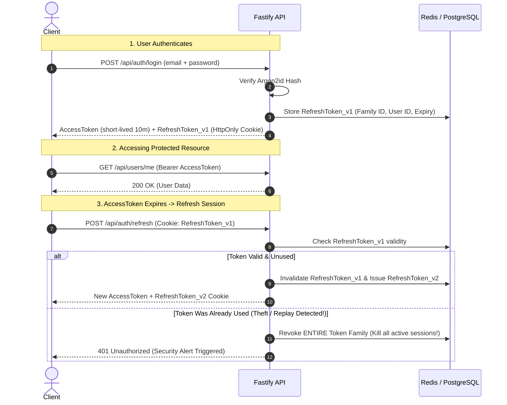

# NexBase Auth Service: Security Architecture & Engineering Notes

This document provides a comprehensive blueprint of security breach prevention mechanisms, cryptographic algorithms, session management patterns, and architectural decisions used in `nexbase-auth-service`.

---

## 1. Attack Vectors & Defense-in-Depth Matrix

| Attack Vector | How Attackers Exploit It | Prevention Mechanism in NexBase |
| :--- | :--- | :--- |
| **Credential Stuffing & Dictionary Attacks** | Automated bots testing leaked password lists against login routes | • Distributed rate limiting using Redis (`@fastify/rate-limit`) • Exponential backoff per IP and per account • Account lockout after $N$ failed attempts |
| **Account Enumeration** | Measuring response differences ("User not found" vs "Wrong password") or timing differences | • Unified message: *"Invalid email or password"* • Dummy hash verification on non-existent accounts so response timing is identical |
| **Database Compromise (Credential Theft)** | Attacker dumps the DB and cracks passwords via GPU/ASIC rainbow tables | • **Argon2id** (memory-hard, resistant to GPU/ASIC parallel attacks) • Unique cryptographically secure salt generated per user |
| **Cross-Site Scripting (XSS)** | Stolen tokens stored in `localStorage` or `sessionStorage` | • Tokens stored in **`HttpOnly`**, **`Secure`**, **`SameSite=Strict`** cookies (JavaScript cannot access them) |
| **Cross-Site Request Forgery (CSRF)** | Malicious third-party sites trigger state-changing requests using user's cookies | • `SameSite=Strict` cookies • Custom header requirement (e.g., `X-Requested-With`) or Double-Submit CSRF cookies |
| **Refresh Token Replay & Hijacking** | Stolen refresh token used repeatedly to gain persistent access | • **Refresh Token Rotation (RTR)**: Each refresh token is strictly single-use • Token family invalidation: if a used token is reused, all tokens for that user session are revoked immediately |
| **Broken Object-Level Authorization (BOLA / IDOR)** | User changes `userId` in request body/URL to modify or view another user's data | • User identity is derived strictly from verified JWT claims/session, never from client-provided query or body parameters |
| **SQL Injection (SQLi)** | Malicious SQL inputs bypassing query logic (`' OR '1'='1`) | • Parameterized queries via Type-Safe Query Builder / ORM (Drizzle/Prisma) • Strict runtime schema validation (Zod) |

---

## 2. Password Hashing: Why Argon2id?

### Argon2id vs Bcrypt vs Scrypt vs PBKDF2

1. **Argon2id** (Winner of the Password Hashing Competition - PHC):
   - **Memory-Hard**: Requires a configurable amount of RAM (e.g., 19MB–64MB) to compute a single hash.
   - **GPU/ASIC Resistant**: While GPUs have massive parallel computing cores, their memory per core is small. Memory-hard algorithms make GPU/ASIC brute-force farms economically unfeasible.
   - **Side-Channel Resistant**: Argon2id blends Argon2d (data-dependent memory access for maximum GPU resistance) and Argon2i (data-independent memory access for side-channel attack resistance).
2. **Bcrypt**:
   - Limited by a 72-byte maximum password length (passwords longer than 72 bytes are silently truncated).
   - CPU-bound rather than memory-hard, making it more vulnerable to modern GPU clusters than Argon2id.

### Timing Attack Mitigation (Constant-Time Dummy Hashing)
When an attacker tries logging in with an email:
- If the email **does not exist**, a naive system returns immediately (`10ms`).
- If the email **exists**, the system computes an Argon2 hash (`80ms`).
- Attackers measure this timing difference to discover which emails are registered.

**Solution**: If user is not found, compute a dummy Argon2 verification against a pre-generated hash so the response time is always identical.

---

## 3. Secure Token Architecture (Refresh Token Rotation)

---

## 4. Database Selection: PostgreSQL vs MySQL

| Criteria | PostgreSQL | MySQL | Why NexBase Uses PostgreSQL |
| :--- | :--- | :--- | :--- |
| **Data Integrity & Standards** | Highly compliant with ANSI SQL standards; strict typing | Historically more permissive; modes can vary behavior | Critical for financial/auth reliability |
| **JSON & Complex Types** | Native `JSONB` with indexing, UUID type, arrays, ranges | Basic JSON support (no dedicated indexing comparable to JSONB) | Ideal for storing device metadata, session tags, and audit logs |
| **Concurrency & MVCC** | Advanced Multi-Version Concurrency Control (MVCC) without table read locks | InnoDB handles concurrency well but table metadata locking can occur | Handles high concurrent auth reads/writes cleanly |
| **Extensions** | Rich ecosystem (`pgcrypto`, `pgvector`, `uuid-ossp`) | Limited extension ecosystem | Native cryptographic & UUID generation |

---

## 5. Types of ORMs & Query Builders in Node.js

1. **Active Record (e.g., TypeORM)**:
   - Models represent tables, and model instances represent rows (`const user = new User(); await user.save();`).
   - Familiar for developers coming from Rails or Django, but couples business logic with database access.
2. **Data Mapper / Schema-First (e.g., Prisma)**:
   - Generates a type-safe client from a `.prisma` schema file.
   - Extremely developer-friendly, but uses an abstraction engine binary that can add overhead.
3. **Type-Safe SQL / Schema-Driven (e.g., Drizzle ORM, Kysely)**:
   - Write TypeScript code that mirrors real SQL (`db.select().from(users).where(...)`).
   - Zero-overhead, maximum performance, pure TypeScript without external binary dependencies.

---

## 6. Implementation Checklist & Phased Roadmap

- [x] **Project Skeleton**: Fastify server, TypeScript ESM, tsconfig, scripts.
- [x] **Security Core**: Argon2id password hashing + timing attack defense.
- [ ] **Config & Environment**: Validated environment variables (Zod + dotenv).
- [ ] **User Registration API**: Input validation schemas, email normalization, hashed storage.
- [ ] **Database Connection**: PostgreSQL connection with migration tooling.
- [ ] **JWT & Refresh Token Rotation**: Fastify JWT & cookie plugins, session family invalidation.
- [ ] **Rate Limiting & Security Headers**: `@fastify/rate-limit`, `@fastify/helmet`, CORS.
- [ ] **Multi-Factor Authentication**: TOTP RFC 6238 and emergency recovery codes.

